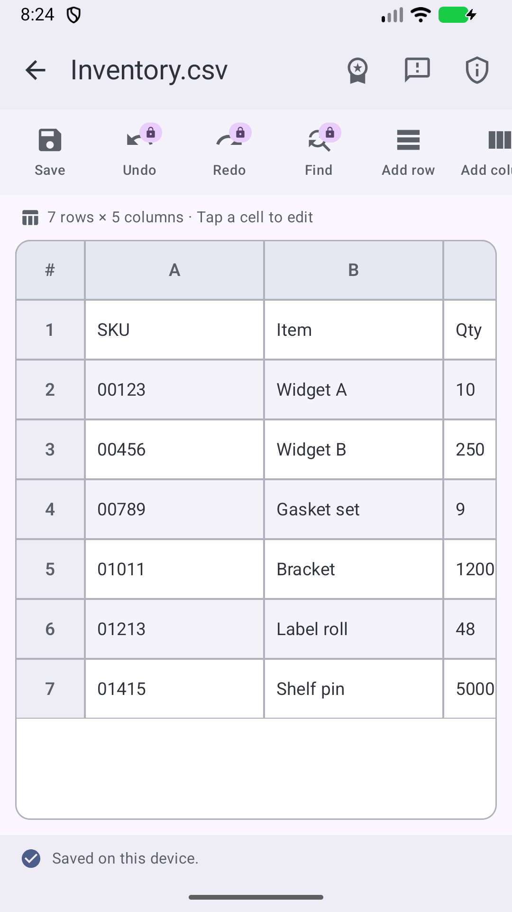
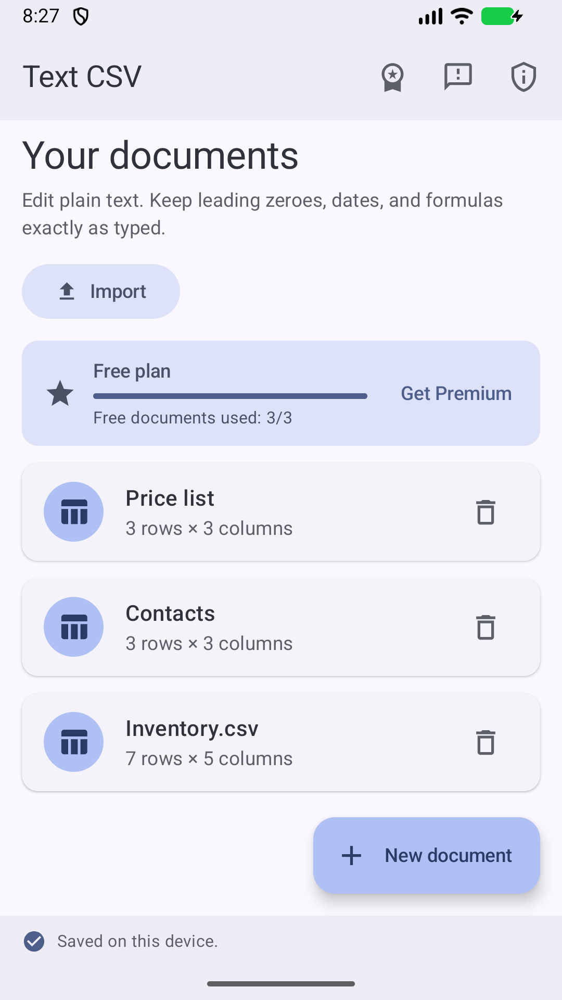

<!-- Authoring guidance: dev-docs/specs/README_SPEC.instructions.md -->
<!-- rumdl-disable MD033 MD041 -->

  

<h1 align="center">Text CSV</h1>

  A plain-text CSV and TSV editor for Android, Windows, and iPhone, for anyone
  who needs to view or change delimited files without a full spreadsheet
  program.

  
  
  

<!-- rumdl-enable MD033 MD041 -->

---

## About

**Development status:** The Android app is available on
[Google Play](https://play.google.com/store/apps/details?id=com.plaintxtoffice.textcsv).
The Windows and iPhone versions have no public download yet.

Spreadsheet programs often change CSV data on the way in, for example by
dropping leading zeroes or turning values into dates and formulas. Text CSV
keeps every cell as the text you typed. Imported files are copied into a local
document library, so the original file never changes, and exports write a clean
UTF-8 CSV wherever you choose. Each platform keeps its own library on the
device.

## Features

- Import CSV, TSV, and plain text files, with commas or tabs detected
  automatically.
- Edit cells as plain text, with no formulas or number conversion.
- Add, insert, and delete rows and columns.
- Save documents in a local library and export UTF-8 CSV copies.
- Recover unsaved edits after an interruption on Windows and iPhone, even when
  the library cannot open.
- Undo and redo, find and replace, sort, filter, and remove duplicate rows on
  Android. The free app keeps up to three documents; some tools need the
  optional Text CSV Premium subscription.
- Copy and paste cell ranges, clear cells, edit multiline cells, rename
  documents, and use keyboard shortcuts on Windows.
- Open CSV and TSV files in Text CSV from other apps on iPhone.
- Keep documents on your device; Text CSV does not send them over the network.

## App Screenshot

### Android

The editor keeps leading zeroes intact, and the document library keeps saved
files together. Click a screenshot to view it at full size.

<!-- rumdl-disable MD033 -->

  
  

<!-- rumdl-enable MD033 -->

## User Manual

See the [User Manual](docs/USER_MANUAL.md) for installation, setup, usage, and
troubleshooting.

## Feedback

Bug reports and feature requests are welcome. In the Android app, choose
**Feedback** in the top bar. You can also use the
[contact form](https://plaintxtoffice.com/contact/) on plaintxtoffice.com.
